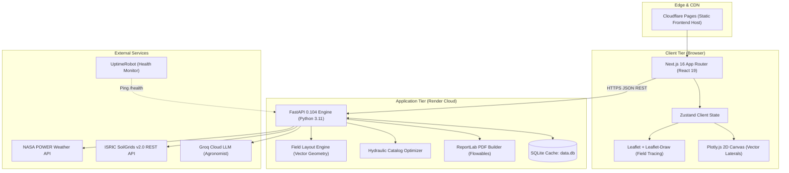
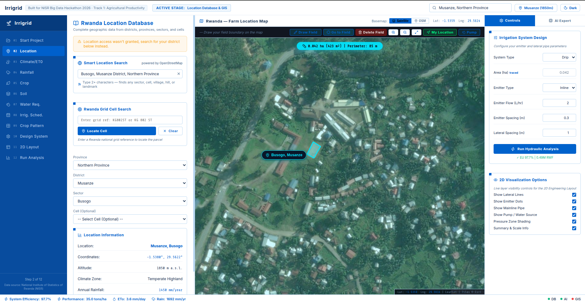
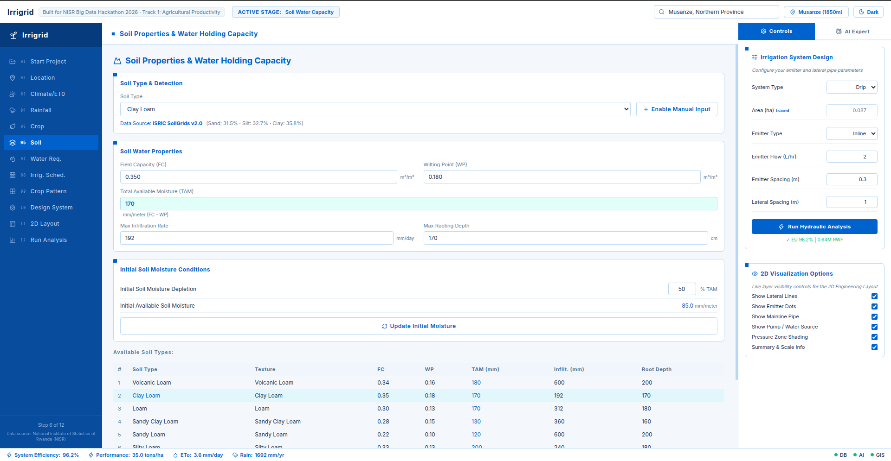
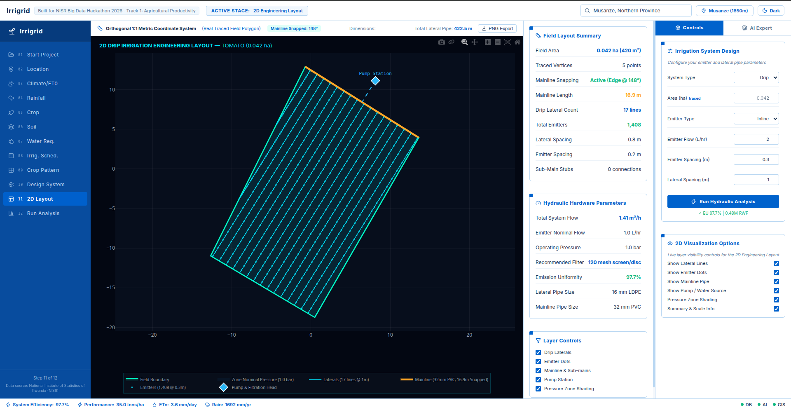
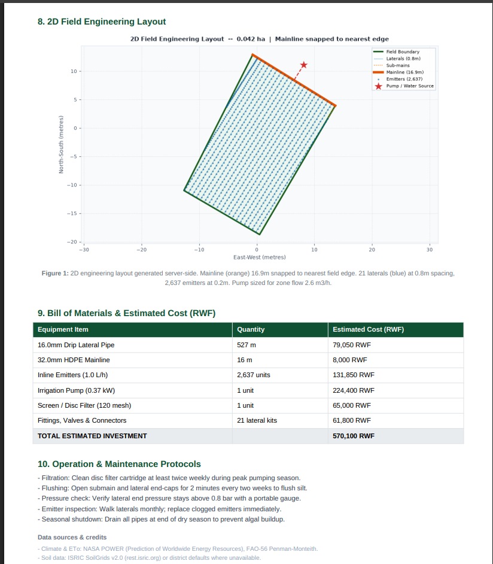

# IrriGrid

**Automated drip irrigation engineering for Rwanda's smallholder farmers.**

[](https://www.python.org/)
[](https://fastapi.tiangolo.com/)
[](https://nextjs.org/)
[](https://irrigrid.pages.dev)
[](https://irrigrid-api.onrender.com)

IrriGrid is a web-based decision support tool designed for non-technical smallholder farmers and agricultural extension officers in Rwanda. A user selects their district and crop, traces their field boundary on an interactive satellite map, and receives a complete, engineering-grade drip irrigation design report (PDF) in seconds. Soil texture, 30-year climatology, crop water requirements, hydraulic pipe sizing, dynamic zoning, 2D field layout, and an itemized bill of materials in Rwandan Francs (RWF) are all generated automatically.

Built for the **National Institute of Statistics of Rwanda (NISR) Big Data Hackathon 2026** — *Track 1: Agricultural Productivity*.

---

## 1. Live Deployment

- **Web Application (Frontend)**: [https://irrigrid.pages.dev](https://irrigrid.pages.dev) (Hosted on Cloudflare Pages)
- **Backend API**: [https://irrigrid-api.onrender.com](https://irrigrid-api.onrender.com) (Hosted on Render Free Tier)
- **API Documentation**: [https://irrigrid-api.onrender.com/docs](https://irrigrid-api.onrender.com/docs) (Interactive OpenAPI/Swagger UI)

> [!NOTE]
> The backend runs on Render's free tier, which spins down containers after 15 minutes of inactivity. If the service is idle, the first request may take 30–60 seconds to wake up. An external keep-alive monitor (UptimeRobot) pings `/health` to keep the instance warm during active demonstration windows.

---

## 1b. Hackathon Submission Contents

| Requirement | Where to find it |
|---|---|
| Public GitHub repository | This repository |
| Deployed app link (public, no login required) | [https://irrigrid.pages.dev](https://irrigrid.pages.dev) |
| README (data used, what it communicates, how to interact) | This file: sections 2, 3, 4, 5, 5b and 7 |
| Code that works on any machine | `backend/` and `frontend/`; setup steps in section 8; dependencies in `backend/requirements.txt` and `frontend/package.json` |
| Demo video (screen recording, under 3 minutes) | `demo/demo.webm` |
| Data files and links | `backend/data/` (NISR SAS 2025 context and district yields, NISR agriculture baseline survey); external datasets are accessed by link as listed in section 5 |

The application needs **no login**, so no sample credentials are required.

---

## 2. The Problem

Smallholder farmers produce the vast majority of Rwanda's domestic food supply on plots averaging **under 0.5 hectares**, yet adoption of modern irrigation remains critically low:

- **Sharp Adoption Disparity**: According to the **NISR Seasonal Agricultural Survey (SAS) 2022 (Season A)**, only **8.2% of Rwandan farmers practice irrigation** overall, split between just **7.0% of small-scale farmers** and **59.8% of large-scale commercial operations**. The **SAS 2025** shows the same gap: irrigation was used by **12.0% of small-scale versus 64.1% of large-scale farmers in Season A** and **10.3% versus 62.0% in Season B** (all crops, all farmers).
- **Underutilized Water Potential**: Rwanda's irrigable potential is about **493,050 hectares**, yet only about **75,223 hectares (roughly 15%)** have been developed (Ministry of Agriculture and Animal Resources, MINAGRI, 2026). Of that potential, **89,535 hectares are suited to small-scale irrigation technologies (SSIT)**. Surface methods such as furrow and flood typically reach 50-60% water efficiency, compared with 85-95% for pressurized drip.
- **The Design Barrier**: Designing an efficient drip system requires computing reference evapotranspiration ($ETo$), soil water depletion thresholds ($TAW$/$RAW$), multi-outlet pipe friction losses, and pump head requirements. Private irrigation consultants and commercial software licenses such as IRRICAD are out of reach for most smallholders, and guesswork frequently results in undersized pumps, severe pressure drops, and clogged emitters.

IrriGrid removes this barrier by automating professional agronomic and hydraulic engineering into an accessible, self-service web interface.

---

## 2b. Alignment with National Priorities (NST2, PSTA 5 and Vision 2050)

IrriGrid is built for the exact gap that Rwanda's current agriculture strategy has to close.

- **NST2 (2024-2029).** The government plans to expand irrigated land from about 71,500 ha (2024) to about 132,000 ha by 2029, and to sustain annual agricultural growth above 6%. The Fifth Strategic Plan for Agriculture Transformation (PSTA 5, 2024-2029) is aligned with NST2.
- **Where the room to grow is.** Of the roughly 493,050 ha of irrigable potential, **89,535 ha is suitable for small-scale irrigation technologies (SSIT)**, which is the farm size IrriGrid designs for.
- **Our contribution to NST2:**
  1. **Removes the design barrier.** A smallholder or extension officer gets an engineering-grade drip design in minutes, which speeds up adoption.
  2. **Loan-ready output.** The PDF includes a bill of materials in RWF, which supports farmers applying for the subsidised loans offered under the SSIT programme.
  3. **Climate resilience and water efficiency.** Drip irrigation replaces low-efficiency surface methods, and net requirements use effective rainfall.
- **Vision 2050.** IrriGrid supports the Vision 2050 goal of a modernised, productive and climate-resilient agriculture sector by making precision irrigation accessible to smallholders, not only to large commercial farms.

*Sources: KT Press, "New irrigation financing aims to improve food security" (Feb 2026); The New Times / AllAfrica, "Govt eyes major irrigation push to boost food security" (Feb 2026); AllAfrica, "Rwanda, EU sign Rwf67bn deal on climate-resilient agriculture" (Aug 2026).*

---

## 3. How It Works


The diagram summarises the workflow; the application guides users through it in 12 detailed steps.

1. **Pick Crop**: Choose from Rwanda's primary staple and horticultural crops. Growth stages, root depths, and FAO-56 crop coefficients ($Kc$) populate automatically.
2. **Find Where to Grow It**: Select a province and district (or search coordinates) for that crop. The system then queries NASA POWER 30-year climatology and ISRIC SoilGrids v2.0 pedotransfer data for the chosen location.
3. **Trace Field**: Draw the exact field boundary on high-resolution satellite imagery using Leaflet tools. Field area (ha), perimeter, and parcel geometry are calculated instantly.
4. **Auto-Ingest Climate & Soil**: Monthly climate, reference evapotranspiration, effective rainfall, and depth-weighted soil properties are loaded for the traced field, with a NISR baseline fallback if a service is slow.
5. **Hydraulic Optimization**: The backend generates parallel lateral rows clipped to the traced polygon, snaps the mainline to the nearest water boundary edge, and evaluates commercial pipe catalogs to guarantee Emission Uniformity ($EU \ge 90\%$).
6. **Instant PDF**: Download a stamped, publication-ready engineering report with an itemized bill of materials in RWF, operational pumping schedules, and a 2D layout drawing.

---

## 4. Key Features

- **Rwanda Administrative Database**: Built-in hierarchy for all 5 provinces and 30 districts, with pre-loaded NISR baseline farm sizes and typical soil profiles.
- **Automated Weather & $ETo$**: 12-month temperature, humidity, wind speed, sunshine hours, and reference evapotranspiration calculated via FAO-56 Penman-Monteith.
- **Rainfall & Effective Rainfall**: Monthly rainfall records combined with the USDA Soil Conservation Service (SCS) method to determine net irrigation requirements.
- **Agronomic Crop Modeling**: Growth-stage specific crop coefficients ($Kc_{\text{ini}}$, $Kc_{\text{mid}}$, $Kc_{\text{end}}$), rooting depths ($Z_r$), and depletion fractions ($p$).
- **Pedological Soil Detection**: Depth-weighted sand, silt, and clay fractions (0–30 cm) from ISRIC SoilGrids v2.0, USDA texture classification, field capacity, wilting point, and saturated hydraulic conductivity.
- **Single-Source 2D Layout**: Server-side vector layout engine generates parallel laterals, samples emitter nodes, snaps mainline headers to field edges, and shares identical geometry with both the web Plotly visualizer and the PDF generator.
- **Polygon-Aware Hydraulics**: Computes Hazen-Williams friction with Christiansen multi-outlet reduction factors ($F$), velocity limits ($\le 1.5\text{ m/s}$), elevation head, filter head loss, dynamic irrigation zones, and pump brake horsepower ($kW$).
- **Rwandan Franc Bill of Materials (BOM)**: Real-world itemized equipment costs (LDPE laterals, HDPE mainlines, inline emitters, 120-mesh disc filters, pump sets, and connector kits) priced in local currency (RWF).
- **AI Agronomist Assistant**: Interactive chat interface powered by Groq LLMs providing localized agronomic guidance and design review, with a deterministic offline fallback.
- **NISR Context Card**: Shows the national small-scale versus large-scale gap from NISR SAS 2025 (irrigation use and maize yield) and the district yield for the selected crop, so every design is placed in its national context.
- **Impact Card**: Modelled water saving of the drip design compared with furrow/flood irrigation, plus total investment and cost per hectare.
- **Executive PDF Export**: Complete 11-section document ready for bank loan applications, cooperative reviews, or extension field work.

---

## 5. Data Sources & Engineering Methodology

| Domain | Source / Dataset | Implementation in IrriGrid |
|---|---|---|
| **Climate & Weather** | [NASA POWER API](https://power.larc.nasa.gov/) | Daily agrometeorology and 30-year climatological monthly averages ($T_{\min}, T_{\max}, RH, U_2, R_s$). |
| **Reference $ETo$** | FAO Irrigation & Drainage Paper 56 | FAO-56 Penman-Monteith equation implemented in `src/core/eto_calculator.py`. |
| **Soil Properties** | [ISRIC SoilGrids v2.0 REST API](https://rest.isric.org/) | Sand, silt, and clay fractions sampled across 0–5 cm, 5–15 cm, and 15–30 cm depths, weighted by layer thickness. |
| **Soil Fallback Chain** | NISR Agriculture Baseline Survey | If SoilGrids times out (>10s), falls back to `backend/data/nisr_ag_survey.csv` district baselines, then standard Loam. |
| **District Crop Yields** | NISR Seasonal Agricultural Survey (SAS) 2025 (Season A) | `backend/data/nisr_yield.json` provides district yields for Maize, Beans, Irish Potato, and Banana, shown in the NISR Context card and the AI Recommendation panel. |
| **National Adoption and Yield Gap** | NISR SAS 2025, Annual Report (Dec 2025) and Season B Report (Oct 2025) | `backend/data/nisr_sas2025_context.json` feeds the NISR Context card (`GET /api/nisr/context`). |
| **Field Geometry** | Leaflet Draw & Shapely | Vector geometric intersection, point-to-segment distance projection, and polygon clipping in `backend/core/field_layout.py`. |

### Agronomic & Hydraulic Formulas

- **Total Available Water (TAW)**:
  $$TAW = 1000 \times (\theta_{FC} - \theta_{WP}) \times Z_r \quad (\text{mm})$$
- **Readily Available Water (RAW)**:
  $$RAW = p \times TAW \quad (\text{mm})$$
- **Irrigation Interval**:
  $$\text{Interval (days)} = \left\lfloor \frac{RAW}{ETc_{\text{peak}}} \right\rfloor$$
- **Effective Rainfall ($P_{\text{eff}}$ - USDA SCS Method)**:
  $$P_{\text{eff}} = \frac{P_{\text{month}} \times (125 - 0.2 \times P_{\text{month}})}{125} \quad (\text{for } P \le 250\text{ mm})$$
- **Emitter Application Rate**:
  $$I_a = \frac{q_{\text{emitter}}}{S_e \times S_l} \quad (\text{mm/h})$$
- **Hazen-Williams Pipe Friction Loss**:
  $$h_f = 10.67 \times L \times \frac{Q^{1.852}}{C^{1.852} \times D^{4.871}} \quad (C = 150 \text{ for PE/PVC})$$
- **Multi-Outlet Reduction Factor (Christiansen $F$)**:
  $$F = \frac{1}{m + 1} + \frac{1}{2N} + \frac{\sqrt{m - 1}}{6N^2} \quad (m = 1.85)$$
- **Total Dynamic Head (TDH)**:
  $$TDH = P_{\text{operating}} + h_{f,\text{lateral}} + h_{f,\text{main}} + h_{\text{filter}} (3.0\text{m}) + \Delta z$$
- **Pump Shaft Power**:
  $$P_{\text{pump}} = \frac{\rho \cdot g \cdot Q_{\text{zone}} \cdot TDH}{\eta \cdot 1000} \quad (\eta = 0.65, \min 0.37\text{ kW})$$
- **Emission Uniformity (Keller-Karmeli EU)**:
  $$EU = 100 \times \frac{q_{\min}}{q_{\text{avg}}}$$
- **Christiansen Uniformity Coefficient (UC)**:
  $$UC = 100 \times \left(1 - \frac{\sum |q_i - \bar{q}|}{N \cdot \bar{q}}\right)$$
  *(Mathematically, $EU \le UC$ is guaranteed across all operational pressure regimes).*

### Production Optimization Method

The production engine (`backend/core/optimizer.py`) executes an **exhaustive discrete catalog grid search** across standard commercial components:
- **Lateral pipe diameters**: $16\text{ mm}, 20\text{ mm}, 25\text{ mm}$ LDPE
- **Mainline pipe diameters**: $32\text{ mm}, 40\text{ mm}, 50\text{ mm}, 63\text{ mm}, 75\text{ mm}, 90\text{ mm}$ HDPE
- **Emitter spacings**: $0.20\text{ m}, 0.30\text{ m}, 0.40\text{ m}, 0.50\text{ m}$
- **Lateral row spacings**: $0.80\text{ m}, 1.00\text{ m}, 1.20\text{ m}, 1.50\text{ m}$
- **Emitter discharge rates**: $1.0\text{ L/h}, 1.6\text{ L/h}, 2.0\text{ L/h}, 2.5\text{ L/h}$

The algorithm evaluates candidate combinations on the exact polygon geometry, enforces $EU \ge 90\%$, mainline velocity $v \le 1.5\text{ m/s}$, and maximum daily pumping duration $\le 12\text{ hours}$, selecting the global minimum investment cost in RWF. *(Note: Multi-objective NSGA-II research scripts using `pymoo` are maintained in `scripts/` for Pareto-frontier research; production relies on discrete catalog search for deterministic, sub-second execution on free-tier RAM).*

> **Institutional Note**: Built independently for the NISR Big Data Hackathon 2026. Not an official product of the National Institute of Statistics of Rwanda.

---

## 5b. How NISR Data Is Used Inside the Application

| NISR dataset | File in the repo | Where it appears in IrriGrid | What it does |
|---|---|---|---|
| Seasonal Agricultural Survey (SAS) 2025: national small-scale vs large-scale irrigation, inputs and maize yields | `backend/data/nisr_sas2025_context.json` | **NISR Context card** on the Design and Results steps | Shows how the user's field compares with the national gap: irrigation use 12.0% (small-scale) vs 64.1% (large-scale) in Season A and 10.3% vs 62.0% in Season B; maize yield 1.9 vs 4.1 t/ha (Season A) and 1.2 vs 4.2 t/ha (Season B) |
| SAS 2025 (Season A) district yields: Maize, Beans, Irish Potato, Banana | `backend/data/nisr_yield.json` | NISR Context card and the AI Recommendation panel | Gives the farmer a local yield reference next to the design |
| NISR Agriculture Baseline Survey | `backend/data/nisr_ag_survey.csv` | Location step, soil fallback chain | Supplies district baseline farm size and soil profile when SoilGrids times out |
| SAS 2022 (Season A) irrigation adoption | cited in section 2 | "The Problem" | Source of the 7.0% (small-scale) vs 59.8% (large-scale) adoption figures |

**Reading notes (also shown in the app):** the SAS irrigation and input shares cover **all crops and all farmers**, not maize alone. "Large-scale" means farms of 10 ha or more, a small group (382 farmers in Season A, 379 in Season B), so large-scale yields are less stable. Seasons A and B are shown separately and are never added together.

---

## 5c. Impact and Worked Example (modelled estimate)

**Who benefits.** Smallholder farmers (average plots under 0.5 ha), agricultural extension officers, cooperatives, banks and SACCOs reviewing loan requests, and NGOs and development partners planning small-scale irrigation.

**Validation status.** The calculation engine was **computationally validated** by the authors in earlier academic testing: 77.8% of 27 test scenarios passed the Emission Uniformity threshold, and the ETo calculation matched FAO-56 with 0.25% mean absolute percentage error. **Field trials have not yet been carried out** and are on the roadmap. All figures below are modelled estimates, not measured farm results.

**Worked example: water saved.** The Impact card computes this for the user's own field from the design's net crop water requirement. The arithmetic, for every 100 m3 of crop water need per season:

| Method | Application efficiency (mid-range) | Water drawn from the source |
|---|---|---|
| Furrow / flood | 55% (range 50-60%) | 100 / 0.55 = **182 m3** |
| Drip (IrriGrid design) | 90% (range 85-95%) | 100 / 0.90 = **111 m3** |
| **Saved** | | **71 m3, about 39% less water** |

**Worked example: cost.** For the demo field in the screenshots (0.042 ha traced in Musanze), the design produces a full bill of materials in RWF and a cost per hectare, so a farmer or lender can see the investment before buying anything.

---

## 6. System Architecture



### Directory Structure

```text
irrigation_dss/
├── backend/
│   ├── cache/             # Local SQLite database (NASA, NDVI & NISR tables)
│   ├── core/              # Hydraulic optimizer, layout geometry, terrain & PDF export
│   ├── data/              # NISR agricultural survey CSVs & SAS 2025 yield JSON
│   ├── ingestion/         # Ingestion clients for NASA POWER, SoilGrids, NDVI & NISR
│   ├── routes/            # FastAPI route handlers (climate, districts, optimize, NISR context, etc.)
│   ├── tests/             # Pytest verification suite & memory profiling scripts
│   ├── main.py            # FastAPI ASGI entrypoint and lifespan manager
│   └── requirements.txt   # Python backend dependencies
├── frontend/
│   ├── src/
│   │   ├── app/           # Next.js App Router root layout and landing page
│   │   ├── components/    # Modular panels (Design, Layout, Results, Map, NISR Context, Impact)
│   │   └── lib/           # API clients, store definitions, types & agronomic calculations
│   ├── package.json       # Frontend package configuration and scripts
│   └── tsconfig.json      # TypeScript compiler configuration
├── data/                  # Reference GIS and administrative boundary datasets
├── demo/                  # Demo screen recording (demo.webm)
├── docs/screenshots/      # Application walkthrough screenshots
├── scripts/               # Offline optimization and Pareto benchmark scripts
├── src/                   # Legacy domain models, crop databases and math modules
├── render.yaml            # Render infrastructure-as-code deployment specification
├── wrangler.toml          # Cloudflare Pages deployment configuration
└── README.md              # Project documentation
```

---

## 7. Interface Walkthrough


| 1. Field Selection & Tracing | 2. Soil Profile & Water Ingestion |
|---|---|
|  |  |
| *Satellite polygon tracing with real-time area calculation.* | *Automatic SoilGrids detection with depth-weighted grain fractions.* |

| 3. Single-Source 2D Engineering Layout | 4. Downloadable PDF Report |
|---|---|
|  |  |
| *Parallel lateral lines, snapped mainline, and pump positioning.* | *Complete 11-section stamped report with bill of materials.* |

---

## 8. Running Locally

### Prerequisites

- **Python**: Version 3.11 or higher
- **Node.js**: Version 20.x or higher
- **npm**: Version 10.x or higher

### Backend Setup

```bash
# 1. Navigate to project root and create virtual environment
cd /path/to/irrigation_dss
python3 -m venv venv
source venv/bin/activate

# 2. Install Python dependencies
pip install -r backend/requirements.txt

# 3. Start the FastAPI development server
uvicorn backend.main:app --host 0.0.0.0 --port 8000 --reload
```
The backend API is now running at `http://localhost:8000` (docs at `http://localhost:8000/docs`).

### Frontend Setup

```bash
# 1. Navigate to frontend folder
cd frontend

# 2. Install dependencies
npm install

# 3. Create local environment file
cat <<EOF > .env.local
NEXT_PUBLIC_API_URL=http://localhost:8000
EOF

# 4. Start Next.js development server
npm run dev
```
Open `http://localhost:3000` in your browser.

### Environment Variables

> **Note for Competition Judges**:
> **You do not need to obtain or configure any API keys to evaluate IrriGrid.**
> - The live deployed web application already has production keys configured in server environment variables.
> - A local run works completely out-of-the-box without keys using built-in offline fallbacks (Rwanda agronomic rule engine, pre-seeded NASA climatology, and regional soil/NDVI baselines).

| Variable | Target (backend/frontend) | Required or optional | Description |
|---|---|---|---|
| `NEXT_PUBLIC_API_URL` | Frontend | Optional (default: `http://localhost:8000`) | Base URL pointing to the FastAPI backend API. |
| `GROQ_API_KEY` | Backend | Optional | API key for live Groq Llama 3.3 / Qwen agronomist inference. Falls back to offline agronomic rule engine if unset. |
| `OPENROUTER_API_KEY` | Backend | Optional | Secondary backup LLM provider key if Groq rate limits or fails. |
| `NDVI_API_KEY` | Backend | Optional | API key for live satellite vegetation health imagery. Falls back to regional agro-climatic baseline if unset. |
| `SENTINEL_HUB_API_KEY` | Backend | Optional | Sentinel Hub API key for satellite vegetation health monitoring. |
| `COPERNICUS_API_KEY` | Backend | Optional | Copernicus Data Space Ecosystem API key for satellite Earth observation. |
| `CONTACT_EMAIL` | Backend | Optional | Contact email included in HTTP User-Agent headers for external APIs (NASA POWER, SoilGrids, Nominatim). |
| `CORS_ORIGINS` | Backend | Optional (default: `https://irrigrid.pages.dev,http://localhost:3000`) | Comma-delimited list of allowed origin domains for CORS policy. |
| `PORT` | Backend | Optional (default: `8000`) | Port to bind the backend server (assigned dynamically by Render in production). |
| `PYTHONPATH` | Backend | Optional (default: `.`) | Module resolution root path for Python execution. |
| `PYTHON_VERSION` | Backend | Optional (default: `3.11.0`) | Target Python runtime version for cloud deployment. |
| `SECRET_KEY` | Backend | Optional | Cryptographic secret key for session signing; auto-generated in production. |
| `DATABASE_URL` | Backend | Optional (default: `sqlite:///./data/irrigation.db`) | SQLite or PostgreSQL connection URL. |
| `DEBUG` | Backend | Optional (default: `False`) | Application debug flag (`True`/`False`). |
| `OPENWEATHER_API_KEY` | Backend | Optional | OpenWeatherMap API key for legacy weather client. |
| `NASA_POWER_API_URL` | Backend | Optional (default: NASA POWER API) | NASA POWER agrometeorology endpoint URL (no key required for basic use). |

---

## 9. Deployment Architecture

### Backend on Render

The backend is deployed as a managed Web Service on Render using `render.yaml`:
- **Build Command**: `pip install -r backend/requirements.txt`
- **Start Command**: `gunicorn -k uvicorn.workers.UvicornWorker -w 1 -b 0.0.0.0:$PORT backend.main:app`
- **Health Check Path**: `/health` (queried on startup to verify readiness)
- **RAM Footprint**: Runs on the free tier (512 MB limit) with a single worker process to prevent out-of-memory container termination.

### Frontend on Cloudflare Pages

The frontend is exported as a static Next.js production build (`output: 'export'`):
- **Build Command**: `npm run build`
- **Build Output Directory**: `frontend/out`
- **Environment Variable**: `NEXT_PUBLIC_API_URL=https://irrigrid-api.onrender.com`
- **CORS Handling**: Backend allows requests from `https://*.pages.dev` and `https://irrigrid.pages.dev`.

---

## 10. Verification & Automated Testing

IrriGrid includes a full unit and integration test suite verifying mathematical consistency, API contracts, polygon operations, and PDF generation.

### Running Pytest

```bash
python -m pytest backend/tests/ -v
```

**Real Test Execution Summary**:
```text
backend/tests/test_ingestion_fallback.py ..                              [  8%]
backend/tests/test_layout.py ....                                        [ 24%]
backend/tests/test_optimizer.py ..........                               [ 64%]
backend/tests/test_routes.py .........                                   [100%]

======================= 25 passed, 5 warnings in 11.98s ========================
```

### Memory Profiling

Render's free tier imposes a strict 512 MB memory boundary. Memory stability is verified across repeated runs on field sizes up to 50 hectares:

```bash
python backend/tests/memory_check.py
```

**Real Benchmark Results**:
```text
BASELINE STARTUP PEAK MEMORY: 245.44 MB
Area (ha)  | Run   | Time (s)   | Peak (MB)    | PDF Size (KB) 
------------------------------------------------------------
0.35       | 1–5   | 0.23–0.38  | 277.74       | 69.9          
2.50       | 1–5   | 0.31–0.36  | 279.78       | 69.8          
10.00      | 1–5   | 0.63–2.05  | 284.96       | 65.3          
50.00      | 1–5   | 1.14–3.03  | 284.96       | 50.7          
============================================================
FINAL PEAK MEMORY: 284.96 MB (Safely within 512 MB limit)
============================================================
```

---

## 11. Known Limitations

- **SoilGrids Resolution & Availability**: ISRIC SoilGrids v2.0 provides ~250m spatial resolution. While sufficient for general soil class identification, localized micro-topography or heavy compost amendments will not be captured. In addition, the public API occasionally experiences latency spikes; IrriGrid handles this through a graceful 10-second timeout fallback to NISR district averages.
- **Terrain Slope Estimation**: When deployed without heavy local digital elevation models (DEM GeoTIFFs are excluded from git repositories due to size), the backend applies an average Rwandan highland baseline slope of 2.0%–2.5%. Users can manually override this value in the interface.
- **Standardized FAO-56 Growth Stages**: Crop coefficients ($Kc$) and growth-stage lengths are parameterized based on standard FAO-56 agro-ecological references for tropical highlands. Localized shifts due to staggered multi-season planting (Season A vs Season B vs Season C) are averaged.
- **Engineering Advisory**: All generated hydraulic calculations, pressures, and bill of materials represent preliminary engineering design estimates. On-site pressure verification and water quality testing by a certified irrigation professional are recommended prior to trenching and piping installation.

---

## 12. Project Roadmap

1. **Dynamic Planting Calendar**: Enable farmers to input their specific planting week to dynamically align $Kc$ curves with historical rainy season peaks.
2. **Cloud DEM Slope Extraction**: Integrate cloud-native SRTM/Copernicus 30m elevation API queries to automatically derive parcel slope without local GeoTIFF files.
3. **Kinyarwanda Localization**: Full multi-language support across the web application and generated PDF reports to empower non-English speaking farmers.
4. **WhatsApp & SMS Dispatch**: Direct PDF report sharing and pumping schedule reminders via Twilio/Africa's Talking integrations.
5. **Multi-Zone Valve Controller Sizing**: Automated manifold and solenoid valve selection for larger cooperative parcels (> 2 hectares).
6. **Field Validation**: Pilot the generated designs with RAB extension officers and cooperative farms to measure real emission uniformity, water use and cost against the model.
7. **Agro-Dealer Pricing Index**: Live crowdsourced pricing feed for irrigation pipes and pumps from commercial agro-dealers in Kigali and Musanze.

---

## 13. Authors & Collaboration

Developed by **Christophe Nshimiyimana** in collaboration with **Faustin Nsengiyumva**.  
Kigali, Rwanda  
*Built for the NISR Big Data Hackathon 2026 (Track 1: Agricultural Productivity)*

---

## 14. Declaration and References

**Declaration of originality.** This submission is our own work. The web application, backend, field layout engine and PDF report were built by the authors for this competition. The agronomic and hydraulic calculation methods are standard published methods, implemented by the authors and all sources of reference are acknowledged below.

**Data and services:** National Institute of Statistics of Rwanda (SAS 2022, SAS 2025, Agriculture Baseline Survey); NASA POWER; ISRIC SoilGrids v2.0; Esri and OpenStreetMap map tiles; Groq (AI assistant).

**Methods:** FAO Irrigation and Drainage Paper 56 (Allen et al., 1998); USDA Soil Conservation Service effective rainfall method; Hazen-Williams friction loss; Christiansen multi-outlet factor and uniformity coefficient; Keller-Karmeli emission uniformity.

**Policy sources:** Rwanda NST2 (2024-2029); PSTA 5 (2024-2029); MINAGRI irrigation statistics (2026), as cited in section 2b.

**Software:** FastAPI, Next.js, React, Leaflet, Plotly, Shapely, ReportLab, Zustand, pymoo (research scripts only).